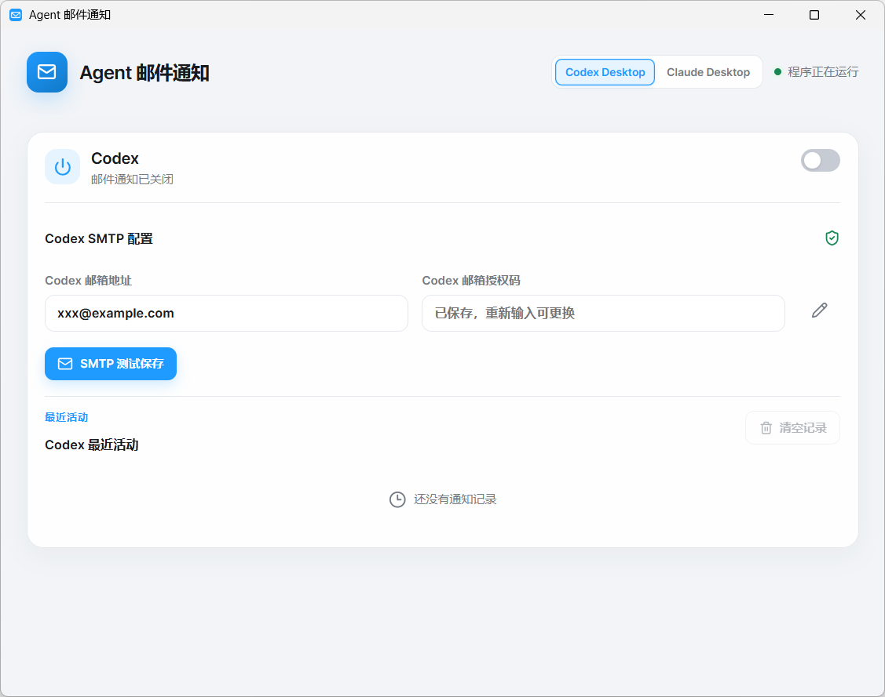
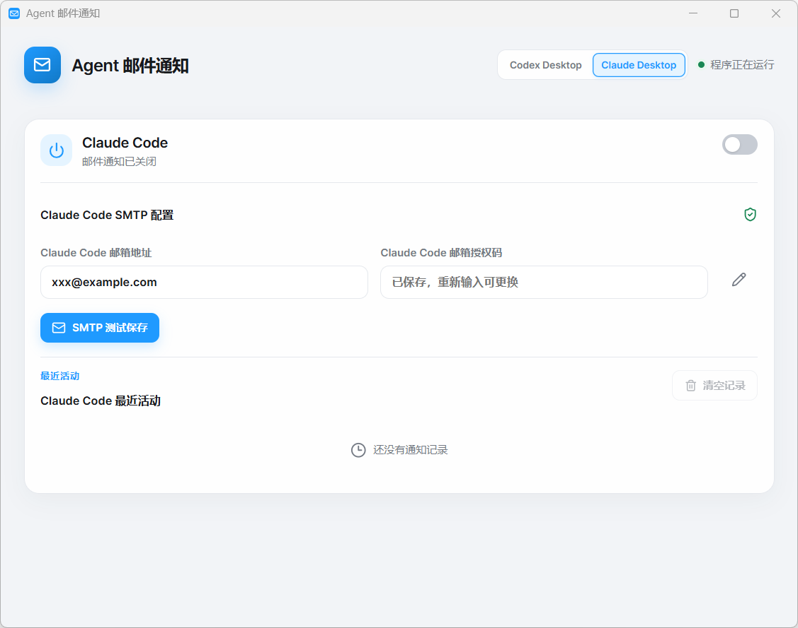

<h1 align="center">Agent Mail Notifier</h1>

<p align="center"><b>Codex Desktop / Claude Code Desktop / CodeBuddy 回复完成邮件通知，支持 Codex 提问提醒</b>（Tauri 2 + Rust + React）</p>

<p align="center">
  <a href="LICENSE"></a>
  <a href="https://github.com/ParatrooperY/AgentMailNotifier/releases"></a>
  
</p>

<p align="center"><a href="README.en.md">English</a> · <b>简体中文</b></p>

## 这是什么

Codex Desktop、Claude Code Desktop 和 CodeBuddy 跑完一轮任务、返回回复后，给你发一封邮件。Codex 中途提出交互问题、等待你回答时，也会发邮件提醒，无需等到整轮任务结束。挂机跑长任务时不用一直守着终端。

程序只读取三个客户端的本地会话记录来识别回复完成和 Codex 提问，无需配置 Hook，也不往它们的配置里写任何东西；SMTP 授权码交给 Windows 凭据管理器保管，不落盘到配置文件。

## 功能

- **通道隔离**：Codex Desktop、Claude Code Desktop 和 CodeBuddy 分别配置发件邮箱；通知记录分开保存；托盘菜单可单独开关任一通道。
- **Codex 提问提醒**：出现交互提问后即可发邮件，包含问题、选项和选项说明；项目名和聊天名可用时也会显示，方便回到对应会话回答。
- **CodeBuddy 完成提醒**：只在整轮回复结束后发邮件，包含本轮问题摘要、回复摘要，以及可用的聊天名称和耗时；通过只读历史记录识别完成状态。
- **凭据安全**：SMTP 授权码存入 Windows 凭据管理器；配置文件只留主机、端口、加密方式等非敏感项；测试成功后输入框自动清空。
- **邮箱预设**：QQ / Foxmail、网易 163 / 126 / yeah.net、Outlook / Hotmail / Live、Gmail 自动补全主机与端口；其它邮箱手填主机、端口、SSL 或 STARTTLS。
- **只读监听**：读取会话记录识别回复完成和 Codex 提问，不修改 Codex、Claude Code 或 CodeBuddy 的配置文件；不建立对外监听端口。
- **事件过滤与去重**：过滤子代理中间事件和程序内部回执；同一任务完成事件、同一个 Codex 问题分别去重，已发送记录会保存到本地，避免日志重复导致重复通知。
- **后台常驻**：关闭窗口后留在系统托盘；托盘菜单用勾选标出三个通道当前的开关状态，退出即彻底停止监听。

## 截图

**Codex Desktop**



**Claude Code Desktop**



## 安装

从 [Releases](https://github.com/ParatrooperY/AgentMailNotifier/releases) 下载：

- **安装包（Setup）** — 推荐。安装到固定路径。
- **便携版（Portable）** — 免安装，可随意放置。移动位置后需要重新启用一次通道。

首个版本没有做代码签名，Windows SmartScreen 可能拦一下，点**更多信息**再点**仍要运行**即可。

## 使用

**第一步，配置邮箱。** 填发件邮箱和授权码，点 SMTP 测试。收到测试邮件说明通了。

授权码不是邮箱登录密码，要去邮箱设置里单独开通 SMTP 服务后获取。QQ 邮箱在「设置 → 账号 → POP3/SMTP 服务」，网易在「设置 → POP3/SMTP/IMAP」。

**第二步，启用通知。** 选择 Codex、Claude Code 或 CodeBuddy 通道，完成该通道的 SMTP 测试后打开开关。

启用 Codex 通道后，交互提问和任务完成都会发送通知。同一个问题只提醒一次；回答后任务完成时，仍会单独发送完成邮件。程序保持运行时，新建会话中的早期提问和完成事件也会被读取。

CodeBuddy 通道仅发送回复完成邮件，提问和权限确认不会单独提醒。请保持通知程序在后台运行；程序启动前已经结束的回复不会补发。

### 支持的邮箱预设

| 邮箱 | SMTP 主机 | 端口 | 加密 |
| --- | --- | --- | --- |
| QQ / Foxmail | smtp.qq.com | 465 | SSL |
| 网易 163 / 126 / yeah.net | smtp.163.com | 465 | SSL |
| Outlook / Hotmail / Live | smtp.office365.com | 587 | STARTTLS |
| Gmail | smtp.gmail.com | 465 | SSL |

其它邮箱选自定义，填主机、端口和加密方式。

## 已知限制

- **只支持 Windows x64**，依赖 Windows 凭据管理器和本机会话记录路径。
- **提问提醒目前只支持 Codex 的交互提问**，普通文字回复中的问句不会触发提问邮件。
- **CodeBuddy 仅支持回复完成提醒**，不提供交互提问或权限弹窗提醒。
- **Claude Code 被长度上限截断的回复不发通知**，判定「一轮结束」依赖会话记录里的收尾标记，正常收尾和被停止串收尾都算完成，但撞到 token 上限的半截回复会跳过。
- **程序没运行时的事件会丢失**，不做离线监听队列，避免重启后收到一堆过期通知。
- **移动安装路径后**，便携版需要重新启用一次通道。

## 技术栈

| 位置   | 技术 | 作用                   |
|------| --- |----------------------|
| 前端   | React 18 + TypeScript 5.6 | 构建界面                 |
| 前端   | Vite 6 | 开发时实时编译，打包时输出静态文件    |
| 前端   | lucide-react | 图标                   |
| 前端测试 | Vitest + Testing Library + jsdom | 假浏览器环境跑界面测试          |
| 后端   | Rust 2024 edition | 监听会话记录、发信、托盘         |
| 后端   | lettre | SMTP 发送信息            |
| 后端   | keyring | 授权码存入 Windows 凭据管理器  |
| 后端   | serde / serde_json | 读写 JSON 配置           |
| 后端   | chrono / uuid | 时间、记录编号              |
| 粘合   | Tauri 2 | 窗口、界面与 Rust 通信、托盘、打包 |
| 打包   | NSIS | Windows 安装程序         |

安装：

- **Node.js**
- **Rust 工具链**
- **Visual Studio Desktop C++ 构建工具** 

### 构建

```bash
npm install
```

### 开发

```bash
npm run tauri dev
```

### 测试

前端部分：

```bash
npm test
```

Rust 部分：

```bash
cargo test --manifest-path src-tauri/Cargo.toml
```

### 构建安装包

```bash
npm run tauri build
```

产物位置：

`src-tauri/target/release/bundle/nsis/` —— 安装包

`src-tauri/target/release/agent-mail-notifier.exe` —— 免安装版

## 项目结构

```
src/                                    React 前端
src-tauri/src/                          Tauri 主进程、状态管理、SMTP 发送
src-tauri/crates/notifier-core/         事件解析、投递判定、SMTP 预设
docs/                                   应用截图
```

前端负责界面，`src-tauri/src/` 负责监听会话记录和发信，`notifier-core` 是不依赖 Tauri 的纯逻辑层，包括事件过滤和投递条件判定。

## 安全说明

- SMTP 授权码只存 Windows 凭据管理器，不写进配置文件、不进通知记录、不出现在界面上。测试成功后输入框会自动清空。
- 程序不修改 Codex、Claude Code 和 CodeBuddy 的配置文件，只读取会话记录。
- 不建立任何对外监听端口，不上传数据到第三方，邮件直接从本机发到配置的 SMTP 服务器。

## 反馈

问题反馈或有改进想法请以 [Issue](https://github.com/ParatrooperY/AgentMailNotifier/issues) 形式反馈，目前不接受PR。

## 许可

[MIT](LICENSE)
